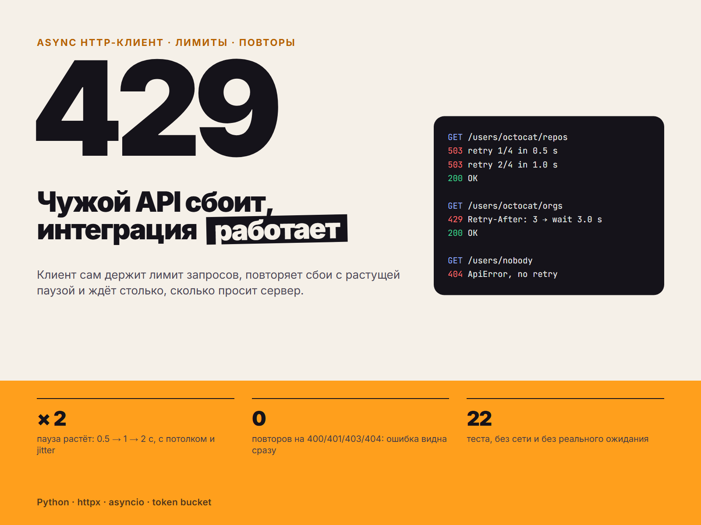

# Resilient API Client

Асинхронный HTTP-клиент на Python для работы с внешними API, которые ограничивают частоту запросов и иногда отвечают ошибками. Клиент сам соблюдает лимит, повторяет неудачные запросы с нарастающей паузой и уважает заголовок `Retry-After`. Именно такие вещи отличают скрипт, который «работает у меня», от надёжной интеграции.



## Возможности

- **Ограничитель частоты** (token bucket): среднее число запросов в секунду и разрешённый «всплеск», безопасно работает при сотнях одновременных корутин
- **Повторы** при временных ошибках: статусы 429, 500, 502, 503, 504, таймауты и обрывы соединения
- **Экспоненциальная пауза с jitter**: задержка растёт 0,5 с, 1 с, 2 с … до заданного потолка, а случайность не даёт всем клиентам повторить запрос в один момент
- **`Retry-After`**: если сервер сам называет паузу, берётся она (с верхним ограничением)
- Ошибки клиента (400, 401, 403, 404) не повторяются и сразу превращаются в понятное `ApiError` со статусом и началом тела ответа
- Время, случайность и транспорт подменяются в тестах, поэтому тесты идут мгновенно и без сети

## Стек

Python 3.10+, [httpx](https://www.python-httpx.org/), pytest, pytest-asyncio

## Установка

```bash
git clone <ссылка-на-репозиторий>
cd resilient-api-client
python -m venv .venv
source .venv/bin/activate        # Windows: .venv\Scripts\activate
pip install -e .
```

## Пример

```python
import asyncio
from resilient_client import ResilientClient, ApiError

async def main():
    async with ResilientClient(
        "https://api.example.com",
        rate_per_sec=5,     # в среднем 5 запросов в секунду
        burst=5,            # можно отправить 5 запросов сразу
        max_retries=4,      # до 4 повторов на запрос
    ) as api:
        try:
            data = await api.get_json("/items", params={"page": 1})
        except ApiError as exc:
            print(exc.status_code, exc)

asyncio.run(main())
```

Готовый запускаемый пример с параллельными запросами к публичному GitHub API: `python examples/github_repos.py`.

## Параметры

| Параметр | По умолчанию | Описание |
| --- | --- | --- |
| `rate_per_sec` | 5.0 | Средняя частота запросов |
| `burst` | 1 | Сколько запросов можно отправить подряд без ожидания |
| `max_retries` | 4 | Число повторов после первой попытки |
| `backoff_base` | 0.5 | Базовая пауза, секунды |
| `backoff_cap` | 30.0 | Максимальная пауза между повторами |
| `max_retry_after` | 60.0 | Потолок для паузы из `Retry-After` |
| `timeout` | 10.0 | Таймаут запроса |
| `headers` | нет | Заголовки по умолчанию (например, `Authorization`) |

Поддерживается числовой `Retry-After` (секунды). Если заголовок в формате даты или отсутствует, используется экспоненциальная пауза.

## Как это устроено

```
resilient_client/
  client.py     ResilientClient: цикл повторов, логирование
  ratelimit.py  AsyncRateLimiter (token bucket)
  backoff.py    расчёт пауз и разбор Retry-After
  errors.py     ApiError
tests/          pytest, без сети и без реальных пауз
examples/       запускаемый пример
```

Каждая попытка, включая повтор, проходит через ограничитель частоты, поэтому повторы не нарушают лимит API.

## Тесты

```bash
pip install -e ".[dev]"
pytest
```

## Что можно доработать

- Поддержка `Retry-After` в формате даты
- Автоматический повтор только идемпотентных методов (сейчас повторяются все, включая POST, будь внимателен с неидемпотентными операциями)
- Метрики: число повторов и время ожидания
- Лимиты по ключам (отдельный лимит на каждый эндпоинт)

## Контакты

Принимаю заказы на интеграции с API, ботов и парсеры. Контакты: Telegram @welldonechief .

## Лицензия

MIT
